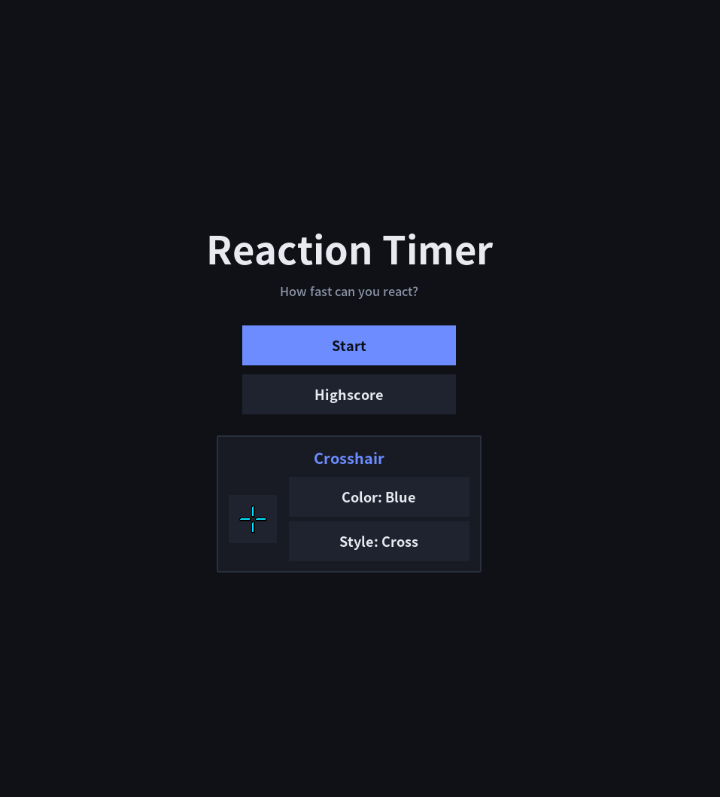

## About
This is a Project bulit for CPSC-223P.
It is a Reaction trainer application written in python!
This app is designed to help users improve their overall
reaction time!

## Features
- Movement/Normal mode
- Different cursor options
- A way to keep your high scores!

## Compilation/Building
source ./venv/bin/activate\
pip install -r requirements.txt

Then simply run below after moving the main directory!\
Linux: pyinstaller --onefile --distpath="../dist" main.py
Windows: pyinstaller --onefile --windowed --distpath="../dist" --add-data="fonts;fonts" main.py
